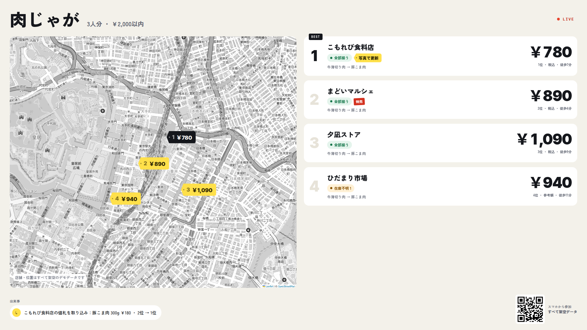
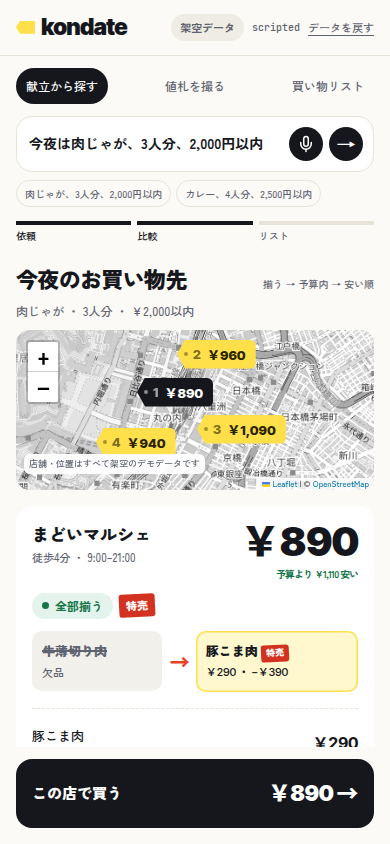
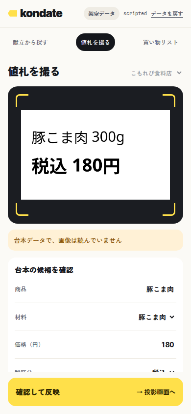
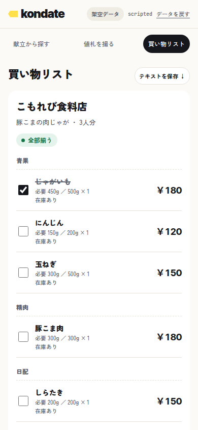

# kondate

日本語 | [English](README.en.md)

今夜の献立を、近くのお店の在庫と特売に合わせて組み替える、買い物エージェントの試作です。値札の写真から価格データを取り込むと、店ごとの合計額と順位がその場で入れ替わります。スマホ用画面とプロジェクター用の投影画面を備えています。

**店舗・商品・価格・在庫・移動時間はすべて架空のデモデータです。** 実在する店舗のデータ、自動収集、注文・購入の機能は含みません。



| スマホ：比較 | スマホ：値札の確認 | スマホ：買い物リスト |
|---|---|---|
|  |  |  |

## できること

- 「肉じゃが、3人分、2,000円以内」のような依頼から、料理・人数・予算・除外食材を読み取る。
- 架空の4店で材料を照合し、在庫・パック数・特売を踏まえた合計額で順位をつける。在庫が分からない材料は「揃う」と数えない。
- 欠品・予算超過・割高のとき、レシピに定義した代替材料（牛薄切り肉 → 豚こま肉など）で組み替えた案を、差額と理由つきで比較する。
- 値札の写真からAIが候補を読み取り、人が確認してから価格データへ反映する。反映はServer-Sent Eventsで投影画面へ届き、行が光り、合計が数え下がり、順位が入れ替わる。
- 選んだ店の買い物リストを売り場の順に表示し、テキストで保存する。

金額は円の100分の1を単位とする整数で計算します。AIに金額計算や在庫判定はさせません。

## 起動

Node.js 24以上とnpmが必要です。DBはNode標準のSQLiteを使います。

```sh
npm ci
npm run dev
```

`http://127.0.0.1:3000` を開きます。本番相当の起動とテストは次のとおりです。

```sh
npm run build
npm start
```

```sh
npm test
```

初回の依存導入には回線が必要です。導入とビルドが済めば、既定の `scripted` での実演は回線なしで動きます。書体は同梱しており、地図タイルを取得できないときは店の一覧に切り替わります。

## AIの提供元

起動するサーバーへ環境変数で渡します。

| 変数 | 既定値・役割 |
|---|---|
| `AI_PROVIDER` | `scripted`（台本どおりの決まった応答。OCRはしない）。ほかに `ollama` |
| `OLLAMA_URL` | `http://127.0.0.1:11434`。Ollamaの `/api/chat` を使う |
| `OLLAMA_TEXT_MODEL` | `qwen3:30b-a3b-instruct-2507-q4_K_M` |
| `OLLAMA_VISION_MODEL` | `qwen3-vl:32b` |
| `OLLAMA_TIMEOUT_MS` | `180000`。再試行を含め最大2要求 |
| `HOST` / `PORT` | `127.0.0.1` / `3000` |
| `MAP_LAT` / `MAP_LNG` | 地図の初期中心。店の座標はデモ用の固定値 |

- AIの応答はJSONスキーマで検証し、通らなければ1回だけ再試行します。2回失敗したら登録済みのレシピに限って動き、値札は手入力へ切り替えます。
- 指定したモデルが導入されていなくても、自動で取得はしません。
- `anthropic` / `openai` は将来の差し込み口だけで、外部APIへの通信は実装していません。

## 投影画面と会場での接続

スマホ用画面は `/`、操作なしで見せる投影画面は `/stage` です。投影するPCで `http://127.0.0.1:3000/stage` を開きます。

スマホから同じLANで接続するときだけ、次のように起動します。

```sh
HOST=0.0.0.0 npm start
```

- 起動ごとに256bitのランダムな鍵を作り、書き込みAPIと撮影画像の閲覧で鍵の一致を検査します。
- 投影画面のQRに `http://<LANのIPv4>:<PORT>/?k=<鍵>` が入ります。スマホで読み取ると、鍵はURLから消え、HttpOnly・SameSite=StrictのCookieに置き換わります。
- 鍵はメモリーにだけ置き、ファイル・localStorageには保存しません。鍵入りのQRは、サーバー自身からの接続にだけ表示します。
- HTTPなので通信は暗号化されません。信頼できるLANでだけ使い、インターネットへ公開しないでください。実在の人や個人情報が写った写真を取り込まないでください。
- 複数のネットワークがあるPCでは、最初に見つかったIPv4をQRに使います。

## デモの流れ（約90秒）

1. PCで `/stage` を開き、スマホでQRを読む。「今夜は肉じゃが、3人分、2,000円以内」を送る。
2. 地図と4店の順位を見る。1位の店は牛薄切り肉が欠品で、豚こま肉に替えると揃い、参考額1,280円が890円になる。
3. 「値札を撮る」で店を選び、値札の写真を撮る（見本は [docs/price-label.png](docs/price-label.png)、`node scripts/fixture.mjs` でも作れる）。内容と在庫を確認して反映すると、その店が960円から780円になり、2位から1位へ上がる。
4. 「この店で買う」で、売り場の順に並んだ買い物リストを見る。

「データを戻す」で、価格・写真・現在の依頼を初期状態へ戻せます。完全に作り直すときは、停止してから `data/` を削除して起動し直します。

## データの置き場

- SQLite：`data/kondate.sqlite`。撮影画像は位置情報を除いたPNGとして `data/captures/` に保存し、元の画像は保存しません。
- `data/`・依存・ビルド結果はGitの対象外です。

## 制限

- 実機のスマホのカメラ・音声入力、会場のLANでの動作は、利用する環境で確認してください。HEIC形式の画像には対応していません。
- 価格は量り売りではなく、買うパック数の合計です。税別価格の端数は100分の1円未満を切り捨てており、実店舗の処理を再現するものではありません。
- 地図はOpenStreetMapのタイルを使い、実在の地図の上に架空の店を置いています。

## ライセンス

[MIT](LICENSE)。依存パッケージと同梱書体のライセンスは [THIRD_PARTY_NOTICES.md](THIRD_PARTY_NOTICES.md) を参照してください。地図データは © OpenStreetMap contributors です。
